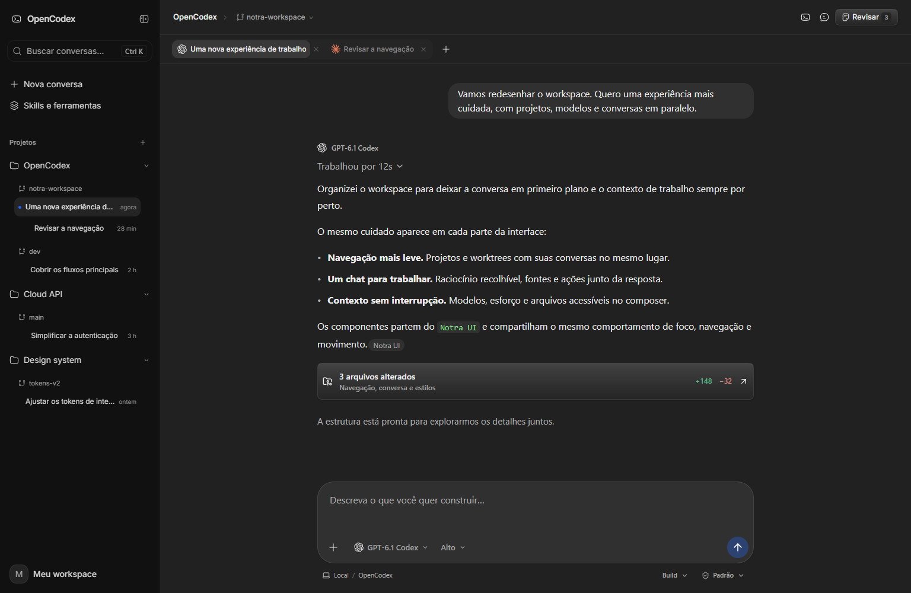

# OpenCodex × Notra UI

Workspace interativo reconstruído com componentes reais do registro oficial do [Notra UI](https://ui.usenotra.com/), combinando o [Thread ChatGPT](https://ui.usenotra.com/components/chatgpt/thread) com navegação, menus, abas, botões, tooltips e seletores do Notra.

## Abrir

A prévia compilada está em **http://127.0.0.1:8791/** enquanto o servidor local estiver ativo. O build é um único arquivo: **`dist/index.html`**, que também abre diretamente, com fontes e ícones incluídos.

Para desenvolver nesta pasta:

```sh
npm ci
npm run dev
```

O servidor de desenvolvimento usa `http://127.0.0.1:8792/`.

Para compilar e verificar:

```sh
npm run typecheck
npm run build
```

Para servir o build a partir da raiz do repositório:

```sh
python -m http.server 8791 --bind 127.0.0.1 --directory prototypes/codex-reference/dist
```

## Explorar

- Projetos e worktrees com conversas agrupadas; criação de projeto e worktree no sandbox.
- Sidebar Notra redimensionável, recolhível para uma rail de ícones e adaptada para uma sheet no mobile.
- Abas Notra com logos, indicador animado, fechar, arrastar e reordenar por teclado.
- ChatGPT Thread/Message/Composer reais: rolagem acompanhada, botão para voltar ao fim, textarea multilinha, rascunhos e anexos separados por conversa.
- Logos em cada modelo, nas abas, no seletor e na identificação da resposta. As famílias OpenAI, Anthropic, Google e xAI usam os vetores do Notra Model Icon.
- Seletor de esforço com o Step Slider do Notra; agente e permissões por conversa.
- Raciocínio expansível, pesquisa, atividade, fontes, citação, app call e ações da resposta.
- Revisão de três arquivos com snippets distintos e estado de conclusão; terminal com comandos de exemplo.
- Ferramentas: MCPs, skills, plugins e conexões demonstrativas.
- Foco, grade e ilhas com arraste e redimensionamento em desktop; tema claro/escuro no menu do workspace.

| Atalho | Ação |
| --- | --- |
| Enter / Shift+Enter | Enviar / inserir linha |
| Ctrl/Cmd+K | Buscar conversas |
| Ctrl/Cmd+B | Recolher ou expandir projetos |
| Alt+1 / Alt+2 / Alt+3 | Foco / grade / ilhas |
| Alt+seta esquerda/direita em uma aba | Reordenar |
| Esc | Fechar menu ou sheet |

## Verificação realizada

- Typecheck com TypeScript Native e build Vite concluídos.
- Lint direcionado do código da aplicação sem avisos.
- Chromium isolado, build de produção: modelos/logos, esforço por slider, rascunhos, atividade/fontes, anexos e prévia, envio, interrupção, conclusão, projetos/worktrees, busca, ferramentas, terminal, grade/ilhas e recuperação após fechar todas as abas. Sem erros de console no percurso.
- Claro e escuro em 320, 390, 768 e 1536 px; menus dentro do viewport, reordenação por teclado, movimento reduzido e abertura offline por `file://`.
- Revisão visual independente das nove capturas de desktop, mobile, modelos, esforço, revisão e atividade: sem achados materiais.
- O check do monorepo (`bun run check`) foi tentado e interrompido por falta das dependências da raiz (`oxlint`). Esta pasta tem dependências próprias; nenhum pacote de produção foi alterado.

## Limites

É um protótipo de interface independente. Conversas, respostas, catálogo de modelos, arquivos e diffs são ilustrativos. O streaming é simulado e não chama modelos. Os anexos têm prévia local, sem upload ou anotação; após enviar, a conversa registra seus nomes. Criar projetos/worktrees não altera o sistema de arquivos. O terminal responde a `help`, `pwd`, `ls`, `git status`, `git branch` e `clear` sem executar processos. MCPs, plugins e conexões não acionam serviços externos. O estado das conversas reinicia ao recarregar; somente o tema e a preferência da sidebar persistem. Firefox, Safari e integração com o aplicativo instalado não foram validados.

## Origem

Foram instaladas 103 fontes de componentes e primitivas, com o bloco ChatGPT completo e os componentes Notra usados pelo workspace. [THIRD_PARTY.md](./THIRD_PARTY.md) registra a origem e as adaptações; `NOTRA_COMPONENTS.json` lista os itens e hashes recebidos. Componentes adicionais do catálogo permanecem disponíveis no código sem inserir telas sem função no workspace.


