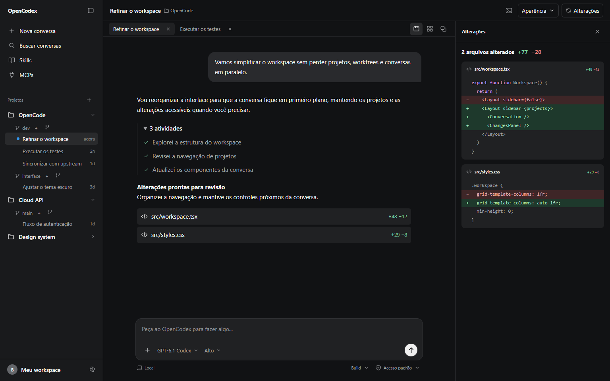

# OpenCodex — estudo de interface

Abra `index.html` diretamente no navegador ou execute, na raiz do repositório:

```sh
python -m http.server 8791 --bind 127.0.0.1 --directory prototypes/codex-reference
```

O mesmo workspace pode ser aberto em três composições: [Foco escuro](./index.html?view=focus), [Claro](./index.html?view=light) e [Revisão](./index.html?view=review). O controle **Aparência** alterna entre elas. O painel de alterações pode ser aberto e fechado independentemente.

Projetos, worktrees, conversas, abas, grade e ilhas, busca, modelo, esforço e agente por conversa, anexos com prévia, MCPs, plugins e provedores podem ser explorados. As configurações estão na engrenagem inferior; o terminal fica na barra superior. Os rascunhos e anexos pertencem a cada conversa. Arquivos abrem o painel de revisão; sessões sem alterações mostram o estado vazio. O envio permite interromper a resposta simulada.

As ilhas podem ser arrastadas pelo cabeçalho e redimensionadas pelo canto inferior; **Organizar ilhas** restaura suas posições. Em telas estreitas, viram uma sequência de painéis. O título de cada painel volta à conversa em foco. As abas aceitam arrastar e soltar ou `Alt+Seta esquerda/direita` quando estão em foco.

| Atalho | Ação |
| --- | --- |
| Enter / Shift+Enter | Enviar / nova linha |
| Ctrl/Cmd+K | Buscar conversas |
| Ctrl/Cmd+B | Mostrar ou ocultar projetos |
| Ctrl/Cmd+W | Fechar a conversa ativa |
| Alt+1 / Alt+2 / Alt+3 | Abas / grade / ilhas |
| Esc | Fechar seletor ou janela |



## Limites da demonstração

Este diretório é independente e não altera o aplicativo instalado. Conteúdo, nomes de modelos, arquivos, alterações, respostas e integrações são exemplos, não um catálogo atual de serviços. O envio simula uma resposta e não chama modelos. As imagens têm prévia local, sem upload ou anotações; após enviar, a mensagem registra o nome do anexo. MCPs, plugins e conexões API/CLI são fluxos demonstrativos. O terminal responde somente aos comandos de exemplo (`help`, `pwd`, `ls`, `git status`, `git branch`, `clear`); não executa processos. Criar projetos ou worktrees não toca o sistema de arquivos. Estado e rascunhos vivem em memória e reiniciam ao recarregar. A integração com o aplicativo e suas APIs continua fora deste estudo visual.

## Verificação

- Chromium isolado: três composições em 320, 390, 768 e 1536 px; sem overflow horizontal da página após as transições.
- Percurso funcional: rascunhos/anexos e modelo/esforço por conversa; envio, conclusão e interrupção; criação de projeto/worktree e navegação; busca; revisão vazia; plugins e conexões demonstrativas; terminal; recuperação após fechar todas as abas.
- Grade, arraste e redimensionamento de ilhas; reordenação de abas por teclado; preservação de foco, seleção e rolagem; movimento reduzido; abertura direta via `file://`.
- Sintaxe JavaScript e lint básico dos arquivos locais. Revisão visual independente comparada às referências fornecidas.
- `bun run check` do monorepo foi tentado via Bun e interrompido por dependências ausentes (`oxlint`; a configuração também depende de `@oxlint/plugins`). Nenhum pacote de produção foi alterado. Não foram validados Firefox, Safari, integrações reais ou distribuição portable.
